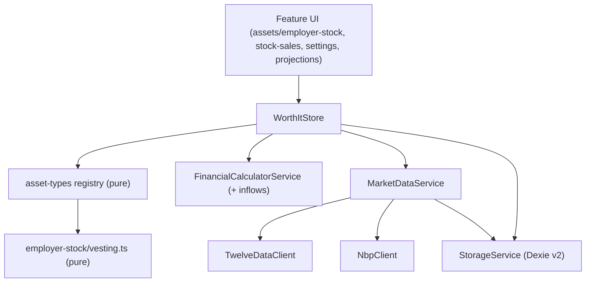

# Employer Stock — Code Architecture (binding contract)

Source of truth for behaviour: [`PRODUCT_SPECIFICATION.md`](../../PRODUCT_SPECIFICATION.md) §5, §6, §9.2, §11, §12, §13.
Coding rules: [`docs/CONVENTIONS.md`](../CONVENTIONS.md) (Signal Forms only, OnPush, no `any`, store-only access from UI).
UX source of truth: `docs/ux/employer-stock-ux.md` (written by the `ux` worker).

This document fixes **names, file locations and signatures**. Workers may add private helpers but must not
rename or change the public contracts below without coordinator approval.

---

## 1. Design goals

1. **Per-asset-type strategy.** Valuation and projection behaviour is resolved through an
   `AssetTypeHandler` registry keyed by `AssetType`. Employer stock is the first specialised handler;
   all other types use the default `balanceHandler` (today's behaviour). Future types
   (`stocks_etf`, `retirement`, …) are added by writing a new handler + an optional `<type>Details`
   sub-object on `Asset` — no changes to the calculator or store wiring.
2. **Pure domain core.** Vesting, held-share and valuation math are pure functions (no Angular DI, no
   `Date.now()` inside — `today` is always passed in as an ISO `yyyy-mm-dd` string). 100% unit-testable.
3. **Adapter into the existing calculator.** `FinancialCalculatorService` wealth math is NOT rewritten.
   The store converts every asset into a *valued asset* (`balance` = value in asset currency,
   `exchangeRateToBase` = resolved FX rate) and feeds those into the existing methods.
4. **Discrete projected inflows.** Projections gain one new concept: `ProjectedInflow` (a dated lump sum
   in base currency). Employer-stock future tranches produce inflows; the calculator's goal/cushion
   timeline consumes them alongside the monthly surplus.
5. **Offline-first market data.** Twelve Data (price) and NBP (FX) responses are cached in IndexedDB.
   Valuation only ever reads the cache (plus manual overrides); network refresh is a separate,
   explicit side effect.



---

## 2. File map & ownership

| Path | Owner |
| :--- | :--- |
| `src/app/core/models/employer-stock.model.ts` (new) | domain |
| `src/app/core/models/market-data.model.ts` (new) | data |
| `src/app/core/models/worth-it.model.ts` (edit: `Asset.employerStock`, `StockSale.sourceAssetId`, `ApplicationSettings.twelveDataApiKey`, backup arrays) | data |
| `src/app/core/asset-types/**` (new: registry, handlers, vesting, projection helpers + specs) | domain |
| `src/app/core/services/financial-calculator.service.ts` (+ spec) — inflow-aware projections | domain |
| `src/app/core/services/storage.service.ts` (+ spec) — Dexie v2, CRUD, backup | data |
| `src/app/core/services/market-data/**` (new: clients, service, specs) | data |
| `src/app/app.config.ts` (add `provideHttpClient(withFetch())`) | data |
| `src/app/core/stores/worth-it.store.ts` (+ spec) | domain (after data hands off) |
| `src/app/features/assets/**`, `src/app/app.routes.ts` | ui-stock |
| `src/app/features/stock-sales/**`, `features/settings/**`, `features/cashflow/**`, `features/projections/**`, `features/dashboard/**` | ui-misc |
| `src/app/shared/**` (new shared components only, e.g. `market-status-badge`) | ui-stock |
| `docs/ux/employer-stock-ux.md` | ux |

---

## 3. Data model

### 3.1 `core/models/employer-stock.model.ts`

```ts
export type VestingFrequency = 'monthly' | 'quarterly' | 'annual';

export interface VestingScheduleParams {
  frequency: VestingFrequency;
  /** Total vesting period in months (e.g. 12, 24, 36, 48). Must be a multiple of the period length. */
  durationMonths: number;
  /** Months after grantDate before the first vest. 0 = no cliff. Tranches before the cliff are merged into the cliff tranche. */
  cliffMonths: number;
  /** Optional explicit first vest date (yyyy-mm-dd). If set, tranche k vests at firstVestDate + (k-1)·period; cliff is ignored. */
  firstVestDate?: string;
}

export interface VestingTranche {
  id: string;
  vestDate: string; // yyyy-mm-dd
  shares: number;   // > 0
}

export interface StockGrant {
  id: string;
  assetId: string;          // FK → Asset.id (type 'employer_stock')
  name?: string;
  grantDate: string;        // yyyy-mm-dd
  totalShares: number;      // net shares (no tax handling — spec §8)
  schedule: VestingScheduleParams;
  /** Concrete, user-editable schedule. Source of truth for all math. */
  tranches: VestingTranche[];
  /** true once the user edited any tranche manually (UI warns before regenerating). */
  isScheduleCustomized: boolean;
  createdAt: string;
  updatedAt: string;
}

/** Type-specific configuration stored on Asset.employerStock. */
export interface EmployerStockDetails {
  tickerSymbol: string;               // upper-case, e.g. 'GOOGL'
  /** Optional baseline: the user states "I hold N vested shares as of date D" (spec §6.1/§6.3). */
  vestedSharesBaseline?: number;
  vestedSharesBaselineDate?: string;  // yyyy-mm-dd, required when baseline is set
  /** Manual fallbacks used when no cached API value exists (or the user prefers manual). */
  manualPrice?: number;               // in Asset.currency
  manualFxRate?: number;              // 1 Asset.currency = N base currency
}

export interface EmployerStockSnapshot {
  assetId: string;
  date: string;
  totalGrantedShares: number;
  vestedSharesGross: number;   // Σ tranches with vestDate ≤ date (ignores baseline)
  heldShares: number;          // per spec §6.3 (baseline-aware, minus linked sales)
  unvestedShares: number;      // Σ tranches with vestDate > date
  soldSharesCounted: number;   // linked sales actually subtracted
  nextVest?: { date: string; shares: number };
}
```

### 3.2 `core/models/market-data.model.ts`

```ts
export type MarketDataSource = 'twelve_data' | 'nbp' | 'manual';
/** live = fetched within TTL; cached = older than TTL but usable; stale = older than stale limit;
 *  manual = manual override used; missing = nothing available; */
export type MarketDataStatus = 'live' | 'cached' | 'stale' | 'manual' | 'missing';

export interface MarketQuote {
  symbol: string;        // PK, upper-case
  price: number;
  currency: string;      // as reported by Twelve Data
  name?: string;         // instrument name, used to prefill asset name
  exchange?: string;
  fetchedAt: string;     // ISO timestamp
}

export interface FxRate {
  pair: string;          // PK, `${from}/${to}`, e.g. 'USD/PLN'
  from: string;
  to: string;
  rate: number;          // 1 from = rate to
  effectiveDate: string; // NBP table date (yyyy-mm-dd)
  fetchedAt: string;
}

export const QUOTE_TTL_MS = 15 * 60 * 1000;          // 15 min → 'live'
export const QUOTE_STALE_MS = 3 * 24 * 3600 * 1000;  // > 3 days → 'stale'
export const FX_TTL_MS = 12 * 3600 * 1000;
export const FX_STALE_MS = 5 * 24 * 3600 * 1000;     // NBP has no weekend/holiday tables
```

### 3.3 Edits to `worth-it.model.ts`

- `Asset.employerStock?: EmployerStockDetails` (present iff `type === 'employer_stock'`). For employer
  stock `Asset.balance` is **not** used for valuation (keep `0`); `Asset.currency` = trading currency.
- `StockSale.sourceAssetId?: string` — link to an `employer_stock` asset.
- `ApplicationSettings.twelveDataApiKey?: string`.
- `WorthItBackupData.data` gains `stockGrants: StockGrant[]`, `marketQuotes: MarketQuote[]`,
  `fxRates: FxRate[]`; bump backup `version` to `2`; importer accepts v1 (missing arrays → `[]`).

---

## 4. Domain core — `src/app/core/asset-types/`

```
asset-types/
  asset-type-handler.ts        # interfaces below
  asset-type-registry.ts       # ASSET_TYPE_HANDLERS + getAssetTypeHandler()
  balance.handler.ts           # default handler (current behaviour)
  date-utils.ts                # addMonthsClamped, compareIsoDates, daysBetween
  employer-stock/
    vesting.ts                 # pure schedule + share math
    vesting.spec.ts
    employer-stock.handler.ts
    employer-stock.handler.spec.ts
  asset-valuation.ts           # valueAssets(), toValuedAsset(), collectProjectedInflows()
  asset-valuation.spec.ts
```

### 4.1 Handler contract (`asset-type-handler.ts`)

```ts
export interface AssetValuationContext {
  today: string;                                        // yyyy-mm-dd
  baseCurrency: string;
  grantsByAsset: ReadonlyMap<string, readonly StockGrant[]>;
  salesByAsset: ReadonlyMap<string, readonly StockSale[]>;   // only sales with sourceAssetId
  quotes: ReadonlyMap<string, MarketQuote>;             // key: symbol
  fxRates: ReadonlyMap<string, FxRate>;                 // key: 'FROM/TO'
  nowMs: number;                                        // for status (TTL) evaluation
}

export interface AssetValuation {
  assetId: string;
  valueInAssetCurrency: number;
  fxRateToBase: number;        // 1 when currency === baseCurrency
  valueInBase: number;
  priceStatus: MarketDataStatus;   // 'manual' for balance-based assets? → use 'manual'
  fxStatus: MarketDataStatus;
  unitPrice?: number;          // employer stock: price per share in asset currency
  priceAsOf?: string;          // ISO timestamp / date of price used
  fxAsOf?: string;             // NBP effectiveDate of rate used
}

export interface ProjectedInflow {
  date: string;          // yyyy-mm-dd, strictly > today
  amountInBase: number;
  assetId: string;
  sourceId: string;      // e.g. tranche id
  label: string;         // e.g. 'GOOGL vest · 12 sh'
}

export interface AssetTypeHandler {
  readonly type: AssetType;
  value(asset: Asset, ctx: AssetValuationContext): AssetValuation;
  /** Future inflows that are NOT yet part of actual wealth. Default handler returns []. */
  projectedInflows(asset: Asset, ctx: AssetValuationContext): ProjectedInflow[];
}
```

FX resolution (shared helper in `asset-valuation.ts`): if `currency === baseCurrency` → 1 / `'live'`;
else cached `fxRates.get(`${currency}/${base}`)` → status by age; else `manualFxRate` /
`asset.exchangeRateToBase` → `'manual'`; else rate `1`, status `'missing'` (UI must warn).
Balance-based assets keep using `asset.exchangeRateToBase` unless a cached NBP rate exists for their
currency (cached wins) — this gives live FX to every foreign-currency asset for free.

### 4.2 Vesting functions (`employer-stock/vesting.ts`)

```ts
export function generateTranches(grantDate: string, totalShares: number,
  params: VestingScheduleParams, idFactory?: () => string): VestingTranche[];
export function vestedSharesAt(grants: readonly StockGrant[], date: string): number;
export function unvestedSharesAt(grants: readonly StockGrant[], date: string): number;
export function heldSharesAt(details: EmployerStockDetails, grants: readonly StockGrant[],
  sales: readonly StockSale[], date: string): number;
export function employerStockSnapshot(asset: Asset, grants: readonly StockGrant[],
  sales: readonly StockSale[], date: string): EmployerStockSnapshot;
export function futureTranches(grants: readonly StockGrant[], after: string):
  Array<VestingTranche & { grantId: string }>;   // sorted by vestDate asc
export function validateTranches(grant: Pick<StockGrant, 'totalShares' | 'tranches'>): string[]; // human messages
```

Rules (must be covered by tests):
- Period months: monthly 1, quarterly 3, annual 12. `n = durationMonths / period` (reject non-integer).
- Without `firstVestDate`: tranche k vests at `addMonthsClamped(grantDate, k·period)`, k = 1..n.
  Tranches whose date is before `addMonthsClamped(grantDate, cliffMonths)` are merged into the first
  tranche on/after the cliff date. With `firstVestDate`: k-th at `addMonthsClamped(firstVestDate, (k-1)·period)`.
- `addMonthsClamped('2026-01-31', 1) === '2026-02-28'` (clamp to month end, always from the anchor date, never chained).
- Share split: if `totalShares` is an integer → `shares_k = floor(T·k/n) − floor(T·(k−1)/n)` (whole shares,
  sum exact). Otherwise equal split rounded to 4 decimals with the last tranche absorbing the remainder.
- `heldSharesAt` (spec §6.3): without baseline `max(0, vested(≤date) − Σ linked sales with saleDate ≤ date)`;
  with baseline `(B, D)` and `date ≥ D`: `max(0, B + Σ tranches D<vestDate≤date − Σ sales D<saleDate≤date)`;
  if `date < D` fall back to the no-baseline formula.
- All date comparisons are on `yyyy-mm-dd` strings (lexicographic), never `Date` objects with timezones.

### 4.3 Employer stock handler

- `value`: `heldSharesAt(today) × price × fx`. Price resolution: cached quote for `tickerSymbol`
  (status by `QUOTE_TTL_MS`/`QUOTE_STALE_MS`) → `manualPrice` (`'manual'`) → `0` (`'missing'`).
  If the cached quote currency differs from `asset.currency`, trust the quote currency for FX lookup.
- `projectedInflows`: one inflow per tranche with `vestDate > today`, amount = `shares × price × fx`
  at *today's* values (spec §9.2). If baseline date > today (shouldn't happen) skip tranches ≤ baseline date.
- Only goal-eligible assets' inflows are fed to goal projections (filter in `collectProjectedInflows`).

### 4.4 `asset-valuation.ts`

```ts
export function valueAssets(assets: readonly Asset[], ctx: AssetValuationContext): Map<string, AssetValuation>;
/** Adapter for the existing calculator: balance := valueInAssetCurrency, exchangeRateToBase := fxRateToBase. */
export function toValuedAsset(asset: Asset, v: AssetValuation): Asset;
export function collectProjectedInflows(assets: readonly Asset[], ctx: AssetValuationContext,
  opts?: { goalEligibleOnly?: boolean }): ProjectedInflow[];   // default goalEligibleOnly = true, sorted by date
```

---

## 5. Calculator — inflow-aware projections

Add to `FinancialCalculatorService` (keep all existing signatures working; new param is optional and last):

```ts
/** Earliest date the cumulative projected funding F(t) ≥ threshold.
 *  F(t) = monthlySurplus · days(ref→t)/DAYS_PER_MONTH + Σ inflows with date ≤ t.
 *  Returns null if never reached (surplus ≤ 0 and inflows insufficient). threshold ≤ 0 → ref date. */
projectFundingDate(threshold: number, monthlySurplus: number,
  inflows: readonly ProjectedInflow[], referenceDate?: Date): { date: string; months: number } | null;

calculateGoalsFundingSummary(goals, availableGoalWealth, cushionDeficit = 0, monthlySurplus = 0,
  referenceDate?: Date, inflows: readonly ProjectedInflow[] = []): GoalFundingSummary[];
calculateFinancialCushionStatus(goalEligibleWealth, cushion, monthlySurplus = 0,
  referenceDate?: Date, inflows: readonly ProjectedInflow[] = []): FinancialCushionStatus;
calculateProjectionSummary(..., referenceDate?: Date, inflows: readonly ProjectedInflow[] = []): ProjectionSummary;
```

Algorithm for `projectFundingDate`: walk inflows chronologically; segment start value includes inflows
on that date; if value ≥ threshold → that date; if surplus > 0 compute linear crossing inside the
segment; after the last inflow continue linearly if surplus > 0, else `null`. Works for negative
surplus (only inflow instants can reach the threshold). With no inflows it must reproduce today's
results exactly (existing tests stay green). Thresholds are the same cumulative ones used today
(cushion deficit first, then each goal's remaining amount accumulated).

`ProjectionSummary` gains `projectedInflowsTotal: number` and `assumptions: string[]`
(e.g. `'Includes 14 future stock vests valued at today's price and NBP rate'`).

---

## 6. Market data — `src/app/core/services/market-data/`

```
market-data/
  twelve-data.client.ts   # @Injectable; HttpClient
  nbp.client.ts           # @Injectable; HttpClient
  market-data.service.ts  # @Injectable; orchestrates clients + StorageService cache
  *.spec.ts               # HttpTestingController
```

```ts
// TwelveDataClient
getQuote(symbol: string, apiKey: string): Promise<MarketQuote>;
// GET https://api.twelvedata.com/quote?symbol={SYMBOL}&apikey={KEY}
// price = Number(close); currency, name, exchange from payload.
// Error payload {status:'error', code, message} → throw MarketDataError('invalid_symbol'|'auth'|'rate_limit'|'network', message)

// NbpClient
getMidRate(code: string): Promise<{ mid: number; effectiveDate: string }>;
// GET https://api.nbp.pl/api/exchangerates/rates/a/{code}/?format=json → rates[0].mid ; 404 → 'invalid_currency'
getRate(from: string, to: string): Promise<FxRate>;
// PLN mid = 1; rate(from→to) = mid(from) / mid(to); effectiveDate = older of the two.

// MarketDataService
lookupSymbol(symbol: string): Promise<MarketQuote>;                     // always network, caches result
refreshQuotes(symbols: string[], opts?: { force?: boolean }): Promise<MarketRefreshResult>;
refreshFxRates(currencies: string[], base: string, opts?: { force?: boolean }): Promise<MarketRefreshResult>;
// Skips entries still within TTL unless force. Never throws for per-item failures — reports them.
export interface MarketRefreshResult { updated: string[]; skipped: string[]; errors: Array<{ key: string; error: MarketDataError }>; }
```

`MarketDataError extends Error { kind: 'no_api_key' | 'invalid_symbol' | 'invalid_currency' | 'auth' | 'rate_limit' | 'network' | 'unknown' }`.
Missing API key → `no_api_key` without making a request. Offline (`navigator.onLine === false`) → `network` without a request.
Twelve Data free tier = 8 req/min: refresh symbols sequentially, de-duplicated.

---

## 7. Storage (Dexie v2)

```ts
this.version(2).stores({
  // all v1 stores repeated unchanged, plus:
  stockGrants: 'id, assetId',
  marketQuotes: 'symbol',
  fxRates: 'pair',
});
```
CRUD: `getAllStockGrants`, `getStockGrants(assetId)`, `saveStockGrant`, `deleteStockGrant`,
`getAllMarketQuotes`, `saveMarketQuote`, `getAllFxRates`, `saveFxRate`. `deleteAsset` cascades to
its grants and clears `sourceAssetId` on linked sales (sales are history; keep them). `clearAllData`,
export and import include the new tables. Demo seed: add one `employer_stock` asset (e.g. `GOOGL`, USD)
with two grants, a baseline, one linked sale, a cached quote and a `USD/PLN` rate.

---

## 8. Store (`WorthItStore`) additions

State: `stockGrants: StockGrant[]`, `marketQuotes: MarketQuote[]`, `fxRates: FxRate[]`,
`today: string` (set in `loadAll`, refreshable via `refreshToday()`), `marketDataRefreshing: boolean`,
`lastMarketRefresh: MarketRefreshResult | null`.

Computed:
- `valuationContext` → `AssetValuationContext`
- `assetValuations` → `Map<string, AssetValuation>`
- `valuedAssets` → `Asset[]` (via `toValuedAsset`) — **`wealthSummary` and everything downstream must use these**
- `employerStockSnapshots` → `Map<string, EmployerStockSnapshot>`
- `grantsByAsset` → `Map<string, StockGrant[]>`
- `projectedInflows` → `ProjectedInflow[]` (goal-eligible only) → passed to `financialCushionStatus`,
  `goalsWithFunding`, `projectionSummary`
- `employerStockAssets` → `Asset[]`

Methods:
`addStockGrant(input: Omit<StockGrant,'id'|'createdAt'|'updatedAt'>)`, `updateStockGrant(id, patch)`,
`deleteStockGrant(id)`, `setVestedSharesBaseline(assetId, shares, date)`, `clearVestedSharesBaseline(assetId)`,
`lookupTicker(symbol): Promise<MarketQuote>`, `refreshMarketData(opts?: { force?: boolean }): Promise<MarketRefreshResult>`
(quotes for all employer-stock tickers + FX for every non-base asset currency), `refreshToday()`.
`loadAll` loads new tables and fires a non-blocking `refreshMarketData()` when online and an API key exists.

---

## 9. UI architecture (details come from `docs/ux/employer-stock-ux.md`)

```
features/assets/
  assets.ts/.html                 # list: employer-stock cards show held shares, value, unvested, badge; tap → detail
  asset-form-dialog.ts            # type picker; when 'employer_stock' delegates to EmployerStockFormDialog
  employer-stock/
    employer-stock-form-dialog.ts # name, ticker (lookup → prefill name/currency/price), currency, goal toggle
    employer-stock-detail.ts      # route /assets/:assetId — summary, vesting timeline, grants, baseline, linked sales
    grant-editor-dialog.ts        # grant fields + schedule generator + editable tranche rows (Signal Forms)
    vested-baseline-dialog.ts     # "I currently hold N vested shares as of D"
    vesting-timeline.ts           # presentational: tranches over time (past/future), stacked per grant
shared/components/market-status-badge/market-status-badge.ts   # input: status, source, asOf → "USD→PLN · NBP · 2 h ago"
```
`features/stock-sales/stock-sale-dialog.ts`: optional *Source asset* select (employer-stock assets) that
prefills ticker/currency and shows "reduces held shares of <asset>". Settings: Twelve Data API key field
(password input + "Test key" via `store.lookupTicker`) and a privacy note. Cashflow: one-tap
"Annual stock tax" expense preset (one-off actual expense, does not change recurring baseline).
Projections/Dashboard: show projected inflows (upcoming vests) and the assumptions line, visually
distinct from actual values.

---

## 10. Definition of done (whole feature)

- `npx ng build` succeeds; `npx ng test --no-watch` all green (existing + new tests).
- Vesting, held shares (with/without baseline, with linked sales), projectFundingDate and Dexie v1→v2
  migration + backup v1/v2 import are covered by unit tests.
- Unvested shares never appear in actual wealth; projected values are visually distinct.
- Works at 320 px width and on desktop; light & dark themes.
