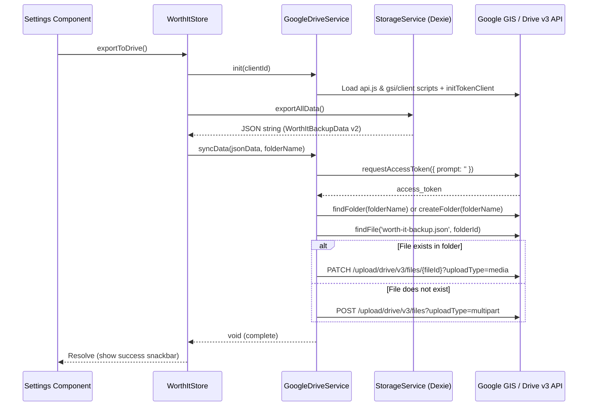

# Google Drive Sync — Feature & Technical Specification

| Product | Platform | Reference Implementation | Architecture |
| :--- | :--- | :--- | :--- |
| **Worth It** | Angular 22 PWA · Material 22 (M3) | [`seen-it`](file:///C:/Users/marek/source/repos/seen-it/src/app/features/settings/settings.ts) (`GoogleDriveService`, `SettingsComponent`) | Offline-first IndexedDB · Google Identity Services (GIS) · Drive API v3 |

*Status: Draft for Review | Created: 18 November 2026*

---

## 1. Overview & Goal

Add a **Google Drive Sync** capability to **Worth It** so users can back up and restore their complete local IndexedDB database (`WorthItDB`) directly to and from a folder in their personal Google Drive account, following the exact integration pattern used in **Seen It** ([`google-drive.service.ts`](file:///C:/Users/marek/source/repos/seen-it/src/app/core/services/google-drive.service.ts) and [`settings.html`](file:///C:/Users/marek/source/repos/seen-it/src/app/features/settings/settings.html)), adapted to Worth It's architecture (`WorthItStore`, Signal Forms, strict TypeScript without `any`, and M3 card layout).

---

## 2. Reference Analysis: How `seen-it` Works vs. `worth-it` Adaptation

| Aspect | `seen-it` Implementation | `worth-it` Adaptation |
| :--- | :--- | :--- |
| **Auth & SDKs** | Dynamically injects `https://apis.google.com/js/api.js` (`gapi` client for Drive v3 discovery) and `https://accounts.google.com/gsi/client` (GIS `initTokenClient`). | Same dynamic script loading & OAuth2 token flow (`GoogleDriveService`), typed with minimal ambient interfaces instead of `any` per [`docs/CONVENTIONS.md`](file:///c:/Users/marek/source/repos/worth-it/docs/CONVENTIONS.md). |
| **OAuth Scope** | `https://www.googleapis.com/auth/drive.file` (per-file access to files/folders created by the app). | Identical scope (`drive.file`). |
| **Settings Fields** | `googleClientId?: string` and `googleDriveBackupFolder?: string` (default `'SeenIt Backups'`) stored in `AppSettings`. | `googleClientId?: string` and `googleDriveBackupFolder?: string` (default `'WorthIt Backups'`) stored in `ApplicationSettings` (`DEFAULT_SETTINGS`). |
| **Remote File Name** | `'seen-it-backup.json'` inside `<googleDriveBackupFolder>`. | `'worth-it-backup.json'` inside `<googleDriveBackupFolder>`. |
| **Backup Payload** | `{ movies, settings }` serialized as JSON. | Full `WorthItBackupData` v2 JSON payload produced by `StorageService.exportAllData()` and validated/restored by `StorageService.importAllData(json)` (all 12 Dexie tables). |
| **Settings Preservation on Import** | Overwrites `settings` table with backup contents. | Restores backup settings via `importAllData()`, while preserving the currently configured `googleClientId` and `googleDriveBackupFolder` if the imported backup had empty/missing values so the user is not disconnected after importing an older backup. |
| **State & Forms** | `ngModel` bindings in `SettingsComponent` calling `SettingsService`. | `@angular/forms/signals` (`form`, `FormRoot`, `FormField`) in `Settings` component talking to `WorthItStore` methods (`exportToDrive`, `importFromDrive`, `updateSettings`). |
| **Import Safety** | Direct overwrite on click. | Confirmation dialog (`ConfirmDialog`) before overwriting local data on `Import from Google Drive`, matching the existing `Restore from JSON backup` flow in Worth It. |

---

## 3. Data Model Changes

### 3.1 `src/app/core/models/worth-it.model.ts`
Extend `ApplicationSettings` with optional Google Drive configuration fields:

```ts
export interface ApplicationSettings {
  id: string;
  baseCurrency: string;
  defaultDashboard: DashboardLayout;
  theme: AppTheme;
  cushion: FinancialCushionSettings;
  twelveDataApiKey?: string;
  googleClientId?: string;
  googleDriveBackupFolder?: string;
}
```

### 3.2 `src/app/core/services/storage.service.ts`
Update `DEFAULT_SETTINGS`:

```ts
export const DEFAULT_SETTINGS: ApplicationSettings = {
  id: 'default',
  baseCurrency: 'PLN',
  defaultDashboard: 'goal_first',
  theme: 'system',
  cushion: {
    isEnabled: true,
    averageMonthlyExpenses: 6000,
    coverageMonths: 6,
  },
  googleDriveBackupFolder: 'WorthIt Backups',
};
```

> **Note on Dexie schema version**: Because `settings` is indexed only by primary key `'id'`, adding optional properties to the `ApplicationSettings` object requires **no** Dexie schema version bump (stays at version 2) and is 100% backward-compatible with v1 and v2 backups.

---

## 4. Service Architecture: `GoogleDriveService`

**File**: `src/app/core/services/google-drive.service.ts`  
**Spec**: `src/app/core/services/google-drive.service.spec.ts`



### 4.1 Public Contract

```ts
export const DEFAULT_DRIVE_BACKUP_FOLDER = 'WorthIt Backups';
export const DRIVE_BACKUP_FILE_NAME = 'worth-it-backup.json';

@Injectable({ providedIn: 'root' })
export class GoogleDriveService {
  /**
   * Loads Google API (gapi) and Google Identity Services (GIS) scripts if not yet loaded,
   * initializes the Drive v3 client, and configures the OAuth2 token client for `clientId`.
   */
  async init(clientId: string): Promise<void>;

  /**
   * Requests an OAuth2 access token with scope `https://www.googleapis.com/auth/drive.file`.
   */
  async authenticate(): Promise<void>;

  /**
   * Finds or creates `folderName` on Google Drive, then creates or updates `worth-it-backup.json`
   * inside that folder with `jsonData`.
   */
  async syncData(jsonData: string, folderName: string): Promise<void>;

  /**
   * Finds `folderName` and `worth-it-backup.json` on Google Drive and downloads the raw JSON text.
   * Throws descriptive errors if the folder or backup file does not exist or download fails.
   */
  async importData(folderName: string): Promise<string>;
}
```

### 4.2 Implementation Details & Hardening over `seen-it`
1. **Strict TypeScript (No `any`)**: Define lightweight internal interfaces (`GapiGlobal`, `GoogleAccountsGlobal`, `GoogleTokenClient`, `GoogleTokenResponse`, `DriveFilesListResponse`) mapped onto `window` so `noImplicitAny` / convention rules are strictly satisfied.
2. **Client ID Re-initialization**: Re-run `initializeGis(clientId)` when `init(clientId)` is called with a changed `clientId`, while avoiding duplicate `<script>` tag injection once `gapiLoaded` / `gisLoaded` are `true`.
3. **Query Escaping**: Escape single quotes in `folderName` when constructing Drive `q` queries (`name='${escapedName}' and mimeType='application/vnd.google-apps.folder' and trashed=false`).
4. **HTTP Response Checking**: Check `response.ok` on both `uploadFile` (`POST`) and `updateFile` (`PATCH`) as well as `importData` (`GET`), throwing an `Error` if Google Drive returns a non-2xx status (e.g., 401/403 expired token, clear `this.accessToken = null` so the next attempt re-authenticates).
5. **Raw String Return on `importData`**: Return `Promise<string>` (`await response.text()`) so `StorageService.importAllData(jsonText)` performs its full schema and referential-integrity validation pipeline.

---

## 5. Store Integration (`WorthItStore`)

**File**: [`src/app/core/stores/worth-it.store.ts`](file:///c:/Users/marek/source/repos/worth-it/src/app/core/stores/worth-it.store.ts)

Per [`docs/CONVENTIONS.md`](file:///c:/Users/marek/source/repos/worth-it/docs/CONVENTIONS.md), components interact with services and persistence through `WorthItStore`. Add two methods to `WorthItStore`:

1. **`exportToDrive(): Promise<void>`**:
   - Reads `googleClientId` and `googleDriveBackupFolder` (fallback to `'WorthIt Backups'`) from `store.settings()`.
   - Throws an error if `googleClientId` is empty.
   - Calls `await driveService.init(clientId)`.
   - Calls `const jsonData = await storage.exportAllData()`.
   - Calls `await driveService.syncData(jsonData, folderName)`.
2. **`importFromDrive(): Promise<void>`**:
   - Reads `googleClientId` and `googleDriveBackupFolder` (fallback to `'WorthIt Backups'`) from `store.settings()`.
   - Throws an error if `googleClientId` is empty.
   - Calls `await driveService.init(clientId)`.
   - Calls `const jsonData = await driveService.importData(folderName)`.
   - Calls `await storage.importAllData(jsonData)`.
   - Ensures `googleClientId` and `googleDriveBackupFolder` remain persisted in `storage.updateSettings(...)` if the imported backup did not include them.
   - Calls `await this.loadAll()` to refresh all store signals and apply the imported theme.

---

## 6. UI & UX Specification (`Settings` Component)

**File**: [`src/app/features/settings/settings.ts`](file:///c:/Users/marek/source/repos/worth-it/src/app/features/settings/settings.ts)

### 6.1 Card Placement & Structure
Add a dedicated **Google Drive Sync** card (`mat-card.settings-card.google-drive-card`) in `Settings` right above the **Backup & Restore** card (and below the **Twelve Data API Key** / **Quick Management** sections):

- **Header**:
  - Avatar Icon: `<mat-icon mat-card-avatar class="card-avatar-icon">cloud_sync</mat-icon>`
  - Title: `Google Drive Sync`
  - Subtitle: `Configure Google Drive integration to backup and restore your data in the cloud`
- **Signal Form (`driveForm`)**:
  - Model:
    ```ts
    export interface GoogleDriveFormModel {
      googleClientId: string;
      googleDriveBackupFolder: string;
    }
    ```
  - Fields:
    1. **Google Client ID**:
       - `<input matInput [type]="hideClientId() ? 'password' : 'text'" [formField]="driveForm.googleClientId" placeholder="Enter your Google OAuth Client ID" autocomplete="off" />`
       - Visibility toggle button (`visibility` / `visibility_off`) matching the Twelve Data API key input pattern.
       - Auto-persists on change / blur or via `[Save Drive Settings]` / before Export & Import actions (if the user types a Client ID or folder name and immediately clicks **Export to Google Drive** or **Import from Google Drive**, the component saves the current form values to `store.updateSettings(...)` first, just like `testApiKey()` does for Twelve Data).
    2. **Backup Folder Name**:
       - `<input matInput [formField]="driveForm.googleDriveBackupFolder" placeholder="WorthIt Backups" />`
       - Trailing icon `<mat-icon matSuffix>folder</mat-icon>`.
- **Action Buttons**:
  - **Save Settings Button** (or automatic save on action + explicit `Save Drive Config` button):
    - Saves `googleClientId` and `googleDriveBackupFolder` (defaulting to `'WorthIt Backups'` if blank) via `store.updateSettings(...)` and shows snackbar `'Google Drive settings saved'`.
  - **Export to Google Drive**:
    - `<button mat-stroked-button color="primary" type="button" (click)="exportToDrive()" [disabled]="isExportingToDrive() || isImportingFromDrive()">`
    - Shows `<mat-spinner class="button-spinner" diameter="20"></mat-spinner>` when `isExportingToDrive()` is `true`, otherwise `<mat-icon>cloud_upload</mat-icon>`.
    - Label: `Export to Google Drive`.
  - **Import from Google Drive**:
    - `<button mat-stroked-button color="primary" type="button" (click)="importFromDrive()" [disabled]="isImportingFromDrive() || isExportingToDrive()">`
    - Shows `<mat-spinner class="button-spinner" diameter="20"></mat-spinner>` when `isImportingFromDrive()` is `true`, otherwise `<mat-icon>cloud_download</mat-icon>`.
    - Label: `Import from Google Drive`.
- **Privacy & Security Callout**:
  - Update the note in the card (and in the Security & Privacy Notice card) to clarify that Google Drive sync is strictly opt-in using the user's own Google OAuth Client ID and `drive.file` scope.

### 6.2 User Flows & Feedback (Snackbars & Dialogs)

1. **Missing Client ID**:
   - Clicking *Export to Google Drive* or *Import from Google Drive* when `googleClientId` is empty displays a snackbar:
     `'Please configure Google Client ID first'` (`duration: 3000`).
2. **Export Flow**:
   - Sets `isExportingToDrive.set(true)`.
   - Persists any unsaved `googleClientId` / `googleDriveBackupFolder` edits from the form model into `store.updateSettings(...)`.
   - Calls `await store.exportToDrive()`.
   - On success: opens snackbar `'Successfully exported to Google Drive!'` (`duration: 3000`).
   - On failure: logs error and opens snackbar `'Failed to export to Google Drive: <reason>'` (`duration: 5000`).
   - Resets `isExportingToDrive.set(false)` in `finally`.
3. **Import Flow**:
   - Validates `googleClientId` is non-empty first; if empty, shows `'Please configure Google Client ID first'`.
   - Opens `ConfirmDialog`:
     - Title: `'Import from Google Drive'`
     - Message: `'Importing from Google Drive will replace all current goals, assets, records, and settings with the backup stored in your Google Drive. Are you sure you want to proceed?'`
     - Confirm button: `'Import Backup'` (`destructive: true`)
   - If confirmed:
     - Sets `isImportingFromDrive.set(true)`.
     - Persists any unsaved `googleClientId` / `googleDriveBackupFolder` edits from the form model.
     - Calls `await store.importFromDrive()`.
     - Syncs `themeService.setTheme(store.settings().theme)` so theme changes in the imported backup take effect immediately.
     - On success: opens snackbar `'Successfully imported from Google Drive!'` (`duration: 3000`).
     - On failure: logs error and opens snackbar `'Failed to import from Google Drive: <reason>'` (`duration: 5000`).
     - Resets `isImportingFromDrive.set(false)` in `finally`.

---

## 7. Files to Create / Modify

| File | Action | Description |
| :--- | :--- | :--- |
| [`docs/specs/google-drive-sync.md`](file:///c:/Users/marek/source/repos/worth-it/docs/specs/google-drive-sync.md) | Create | This specification document in the repo. |
| [`PRODUCT_SPECIFICATION.md`](file:///c:/Users/marek/source/repos/worth-it/PRODUCT_SPECIFICATION.md) | Modify | Update §12 (Settings) & §13.2 (`ApplicationSettings`) to document Google Drive Sync. |
| [`src/app/core/models/worth-it.model.ts`](file:///c:/Users/marek/source/repos/worth-it/src/app/core/models/worth-it.model.ts) | Modify | Add `googleClientId?: string` and `googleDriveBackupFolder?: string` to `ApplicationSettings`. |
| [`src/app/core/services/storage.service.ts`](file:///c:/Users/marek/source/repos/worth-it/src/app/core/services/storage.service.ts) | Modify | Add default `googleDriveBackupFolder: 'WorthIt Backups'` to `DEFAULT_SETTINGS`. |
| `src/app/core/services/google-drive.service.ts` | Create | Google Drive v3 + GIS OAuth2 service (`init`, `authenticate`, `syncData`, `importData`). |
| `src/app/core/services/google-drive.service.spec.ts` | Create | Unit tests for `GoogleDriveService` (script loading, auth, folder/file lookup, create/update multipart upload, import download, error handling). |
| [`src/app/core/stores/worth-it.store.ts`](file:///c:/Users/marek/source/repos/worth-it/src/app/core/stores/worth-it.store.ts) | Modify | Add `exportToDrive()` and `importFromDrive()` store methods. |
| [`src/app/core/stores/worth-it.store.spec.ts`](file:///c:/Users/marek/source/repos/worth-it/src/app/core/stores/worth-it.store.spec.ts) | Modify | Unit tests for store `exportToDrive` and `importFromDrive` methods. |
| [`src/app/features/settings/settings.ts`](file:///c:/Users/marek/source/repos/worth-it/src/app/features/settings/settings.ts) | Modify | Add Google Drive Sync card, Signal Form (`driveForm`), spinner states (`isExportingToDrive`, `isImportingFromDrive`), and handlers. |
| [`src/app/features/settings/settings.spec.ts`](file:///c:/Users/marek/source/repos/worth-it/src/app/features/settings/settings.spec.ts) | Modify | Unit tests for Google Drive Sync settings UI, validation, export, and confirmed import flows. |

---

## 8. Verification & Test Plan

1. **Unit Tests (`npx ng test --no-watch`)**:
   - `GoogleDriveService`:
     - Rejects `init('')` when Client ID is missing.
     - Initializes `gapi.client.drive` and `google.accounts.oauth2.initTokenClient` with `https://www.googleapis.com/auth/drive.file`.
     - `syncData`: creates folder when missing, uploads `worth-it-backup.json` via multipart `POST` when file does not exist, and updates via `PATCH` when file already exists.
     - `importData`: throws when folder or `worth-it-backup.json` is not found; downloads and returns JSON content when found.
   - `WorthItStore`:
     - `exportToDrive()` serializes full `WorthItDB` via `storage.exportAllData()` and passes it to `GoogleDriveService.syncData()`.
     - `importFromDrive()` downloads JSON from `GoogleDriveService.importData()`, imports into `StorageService`, preserves `googleClientId` / `googleDriveBackupFolder`, and reloads store state.
   - `Settings`:
     - Renders Google Drive Sync section with Client ID (password toggle), Backup Folder Name (default `'WorthIt Backups'`), Export, and Import buttons.
     - Shows snackbar warning if Export or Import is clicked without a Client ID.
     - Prompts `ConfirmDialog` before importing from Google Drive and reloads store + theme on confirmation.
2. **Production Build (`npx ng build`)**:
   - Compiles cleanly with zero TypeScript or Angular template warnings/errors.
